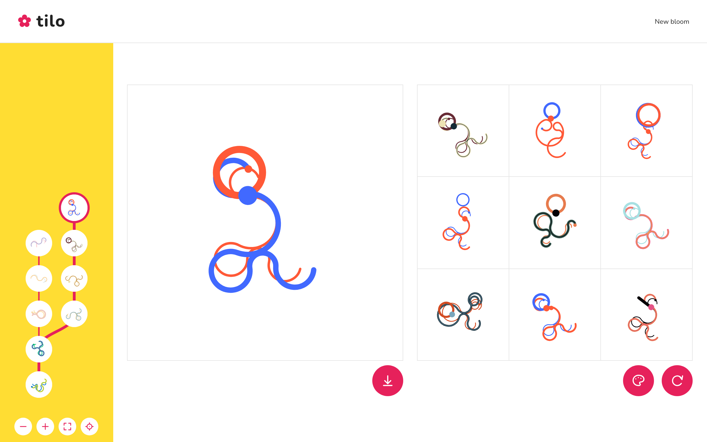

# Tilo

A playful tool for evolving abstract art by choosing what grows next.

[**Try Tilo →**](https://fcor.github.io/tilo/)



## How it works

- Pick a starting bloom.
- Choose from nine variations to grow the next generation.
- Return to earlier blooms to explore another branch.

Explore new colors, re-bloom all traits, or plant another starting bloom. Download your favorite as a 2048×2048 PNG.

The artwork is static. Your picked blooms and branches stay available for the current browser session; reloading starts a new garden.

## Run locally

Use Node.js 22 and npm.

```sh
npm ci
npm run dev
```

Check with `npm test`; create a production build with `npm run build`.

## Contribute

Bug reports, visual feedback and art experiments are welcome. Open an issue or pull request; the [contributor guide](CONTRIBUTING.md) explains the code and artwork.

[Roadmap](ROADMAP.md) · [Art study](BLOOM-STUDY.md) · [Design direction](DESIGN-DIRECTION.md) · [Decisions](DECISIONS.md)

## Credits & license

Inspired by Compton & Mateas’ *Casual Creators* (ICCC 2015) and Chrome Music Lab. Palettes come from Kjetil Golid’s [Chromotome](https://github.com/kgolid/chromotome), with its [MIT license](public/chromotome-license.txt).

Tilo is released under the [MIT license](LICENSE).
